<div align="center">

# ASR_model: Nghiên Cứu và Xây Dựng Mô Hình Nhận Dạng Giọng Nói (ASR) Hỗ Trợ Đánh Giá Phát Âm Tiếng Anh

**End-to-End Speech Recognition System Combining CNN Subsampling, Transformer Encoder & Connectionist Temporal Classification (CTC)**

[](https://www.python.org/)
[](https://pytorch.org/)
[](https://pytorch.org/audio/stable/index.html)
[](https://huggingface.co/)
[](LICENSE)

**Đề tài Nghiên cứu Khoa học Sinh viên – Trường Đại học Thủy Lợi (Phân hiệu TP. Hồ Chí Minh)**  
**Bộ môn:** Công nghệ Thông tin | **Lớp:** S27-66TTNT & S27-66CNTT  

[Báo cáo Nghiên cứu (DOCX)](./docs/Bao_Cao_NCKH_ASR_Model.docx) • [Bộ Custom Tokenizer Ký Tự](./wav2vec2_custom_tokenizer) • [Hướng dẫn Thực nghiệm](#-hướng-dẫn-cài-đặt-và-chạy-thực-nghiệm)

</div>

---

## 📌 1. TỔNG QUAN ĐỀ TÀI

Việc học phát âm tiếng Anh chuẩn đóng vai trò quyết định trong việc nâng cao kỹ năng giao tiếp. Tuy nhiên, người học thường gặp khó khăn do thiếu phản hồi chính xác và chi tiết tức thời.

Đề tài **"Nghiên cứu mô hình ASR để xây dựng ứng dụng học phát âm tiếng Anh"** tập trung thiết kế, huấn luyện và đánh giá mô hình học sâu nhận dạng giọng nói tự động (Automatic Speech Recognition - ASR) theo hướng tiếp cận **End-to-End** kết hợp kiến trúc **CNN Subsampling + Transformer Encoder** cùng hàm mất mát **CTC (Connectionist Temporal Classification)** nhằm:
1. Xây dựng mô hình âm học nhận dạng âm vị và từ vựng có độ chính xác cao đối với ngữ điệu phát âm tiếng Anh của người Việt.
2. Tích hợp bộ giải mã kép (**Greedy Search & Beam Search**) nhằm cân bằng tối ưu giữa độ chính xác nhận dạng và độ trễ xử lý.
3. Cung cấp nền tảng tính toán sai lệch ngữ âm phục vụ mô-đun chấm điểm và đưa ra phản hồi sửa lỗi phát âm cho người học.

---

## 🏗️ 2. KIẾN TRÚC MÔ HÌNH VÀ LUỒNG NHẬN DẠNG (ASR ARCHITECTURE)

### 2.1. Sơ đồ kiến trúc tổng thể mô hình ASR End-to-End
Mô hình kết hợp trích xuất đặc trưng cục bộ bằng CNN và mô hình hóa quan hệ ngữ cảnh chuỗi dài bằng Transformer Encoder:

<div align="center">
  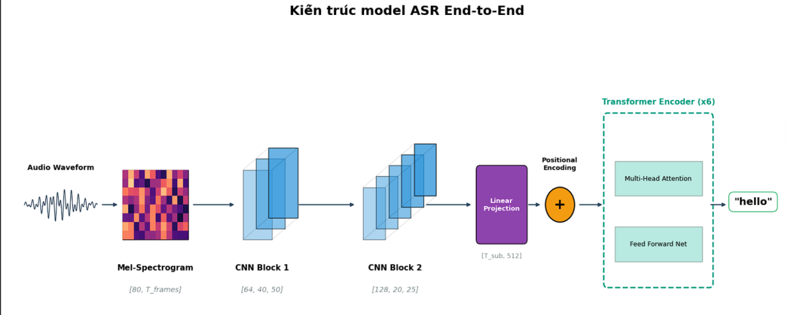
  <p><em>Hình 2.1 – Kiến trúc tổng thể mô hình ASR End-to-End (CNN + Transformer Encoder + CTC).</em></p>
</div>

### 2.2. Biểu diễn phổ âm thanh Log-Mel Spectrogram
Tín hiệu âm thanh dạng sóng được phân tích Fourier ngắn hạn (STFT) thành dạng phổ Mel 80 kênh làm đầu vào cho mạng:

<div align="center">
  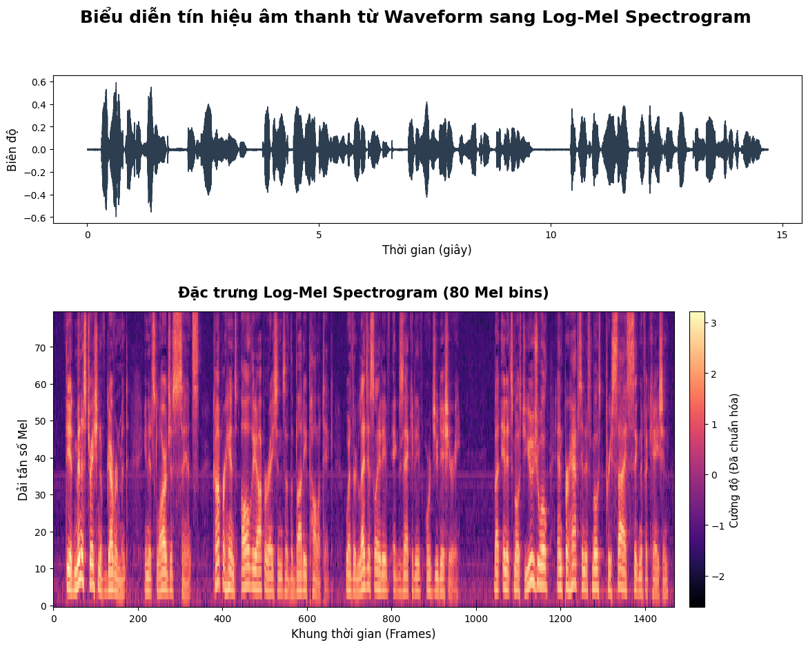
  <p><em>Hình 2.2 – Biểu diễn ma trận Log-Mel Spectrogram từ tệp âm thanh phát âm mẫu.</em></p>
</div>

### 2.3. Khối CNN Subsampling và Feature Maps trích xuất
Khối tích chập 2D (Conv2D) kết hợp bước nhảy (stride) giúp giảm 4 lần chiều thời gian và trích xuất các đặc trưng âm học cơ sở:

<div align="center">
  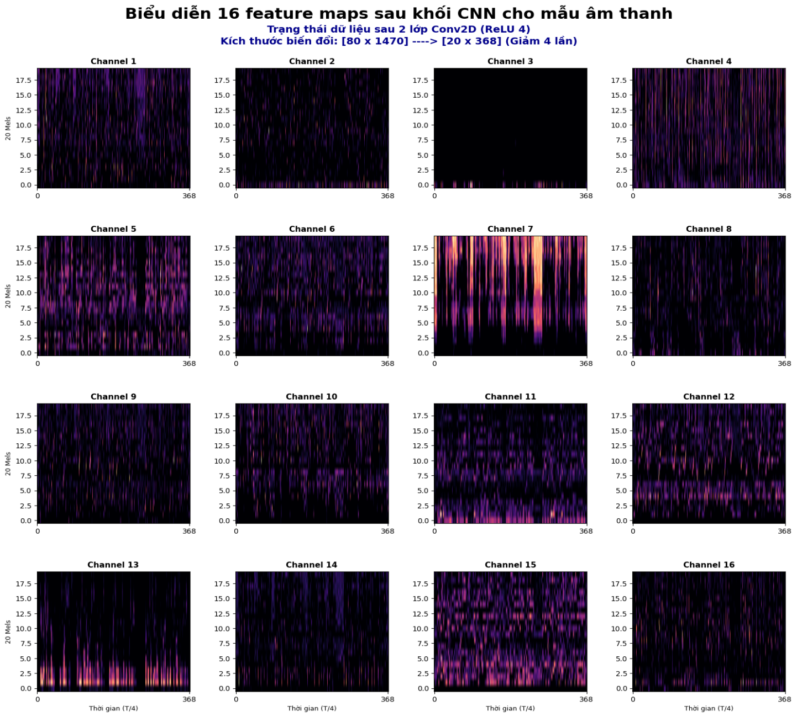
  <p><em>Hình 2.3 – Biểu diễn các bản đồ đặc trưng (Feature Maps) qua các kênh tích chập CNN.</em></p>
</div>

### 2.4. Khối Chiếu không gian Linear Projection và Giải mã Beam Search
Vector đặc trưng sau CNN được chiếu về kích thước ẩn $d_{model} = 512$ trước khi đưa vào các tầng Self-Attention:

<div align="center">
  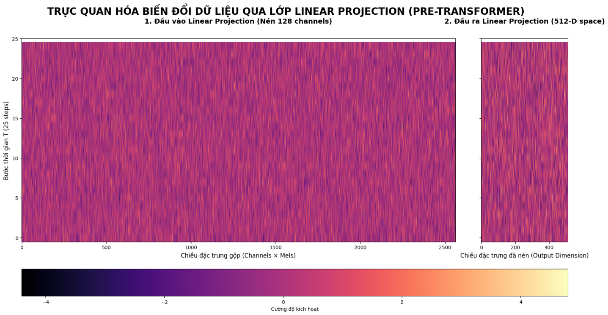
  <p><em>Hình 2.4 – Cấu trúc khối Linear Projection ánh xạ không gian đặc trưng âm học.</em></p>
</div>

<div align="center">
  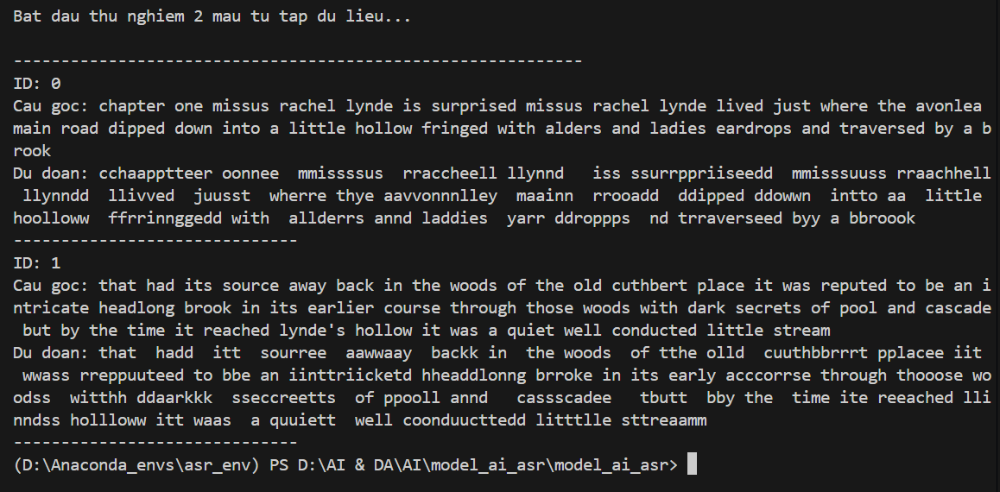
  <p><em>Hình 2.5 – Sơ đồ cây tìm kiếm của thuật toán giải mã Prefix Beam Search kết hợp mô hình ngôn ngữ.</em></p>
</div>

---

## 📱 3. KẾT QUẢ THỰC NGHIỆM VÀ DEMO ỨNG DỤNG THỰC TẾ

### 3.1. Kết quả kiểm tra bộ mã hóa ký tự (Tokenizer) và nhận dạng mẫu
Quá trình mã hóa và giải mã từ điển ký tự tùy biến đảm bảo khớp chính xác giữa nhãn âm học và chuỗi văn bản:

<div align="center">
  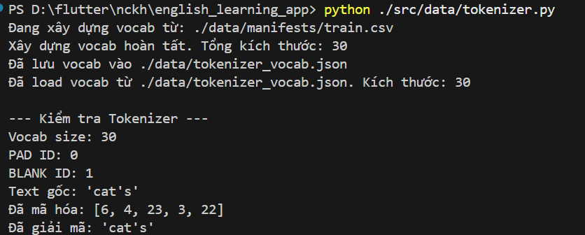
  <p><em>Hình 3.1 – Kết quả thực nghiệm kiểm tra bộ mã hóa ký tự (Character-level Tokenizer).</em></p>
</div>

<div align="center">
  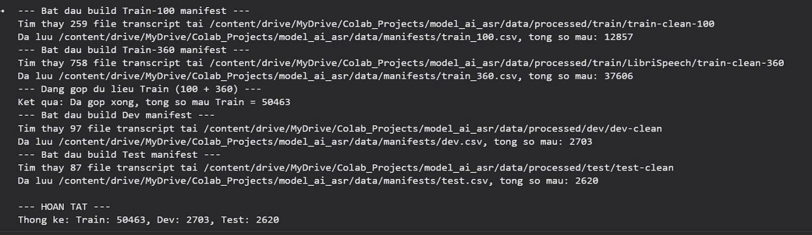
  <p><em>Hình 3.2 – Mẫu kết quả nhận dạng so khớp chuỗi phát âm thực tế so với văn bản gốc.</em></p>
</div>

### 3.2. Kiến trúc hệ thống ứng dụng và Sơ đồ trình tự tương tác (Sequence Diagram)
<div align="center">
  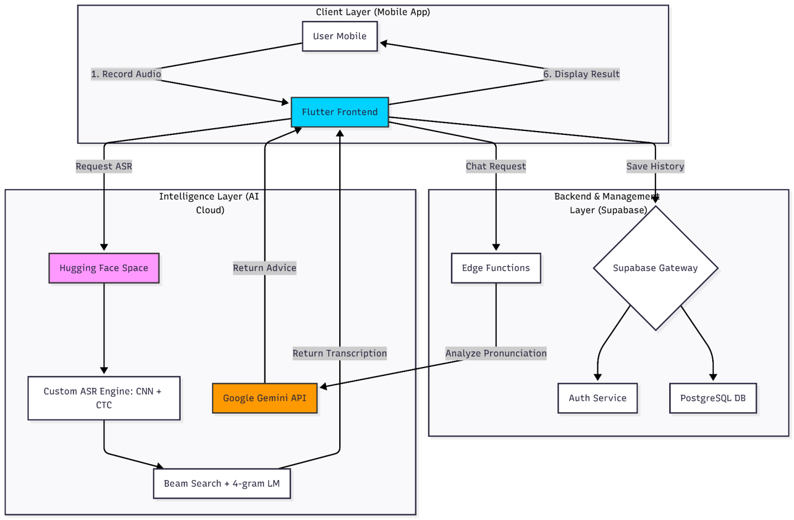
  <p><em>Hình 3.3 – Kiến trúc tổng thể hệ thống ứng dụng học phát âm trên nền tảng di động và backend AI.</em></p>
</div>

<div align="center">
  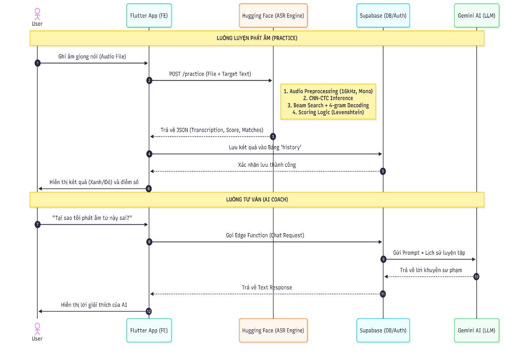
  <p><em>Hình 3.4 – Sơ đồ trình tự (Sequence Diagram) luồng nhận dạng phát âm và tư vấn sửa lỗi qua AI.</em></p>
</div>

### 3.3. Giao diện thực tế của ứng dụng di động hỗ trợ học phát âm
Ứng dụng hoàn chỉnh tích hợp mô-đun nhận dạng giọng nói tức thời và trợ lý học tập đàm thoại thông minh:

<div align="center">
  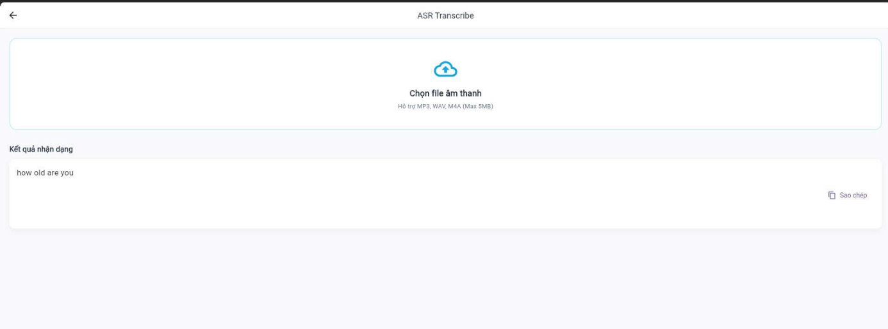
  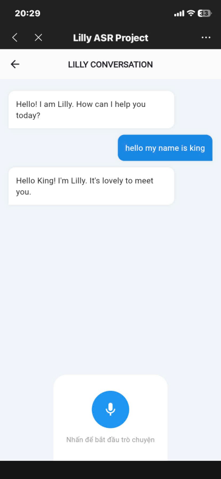
  <p><em>Hình 3.5 – Giao diện module ASR Transcribe ghi âm nhận dạng (trái) và Trợ lý học tập thông minh tương tác giọng nói (phải).</em></p>
</div>

---

## 📂 4. CẤU TRÚC THƯ MỤC DỰ ÁN

```text
ASR_model/
├── docs/                                      # Tài liệu & Báo cáo nghiên cứu khoa học học thuật
│   ├── Bao_Cao_NCKH_ASR_Model.docx            # Bản báo cáo nghiên cứu chi tiết nộp Hội đồng NCKH
│   └── images/                                # Toàn bộ sơ đồ kiến trúc, feature maps & ảnh giao diện demo
├── src/                                       # Mã nguồn lõi của mô hình ASR
│   ├── models/                                # Kiến trúc mô hình mạng nơ-ron
│   │   ├── asr_model.py                       # CNN + Linear Projection + Positional Encoding + Transformer Encoder
│   │   └── utils.py                           # Các hàm xử lý ma trận và tính toán độ dài chuỗi
│   ├── build_corpus.py                        # Xây dựng và tiền xử lý tập ngữ liệu huấn luyện
│   ├── train.py                               # Kịch bản huấn luyện mô hình âm học với hàm mất mát CTC
│   ├── fine_tune_model.py                     # Kịch bản tinh chỉnh (Fine-tuning) mô hình
│   ├── evaluate.py                            # Kịch bản tính toán các chỉ số lỗi WER và CER
│   ├── inference.py                           # Nhận dạng giọng nói giải mã Greedy Search (Argmax)
│   ├── inference_beam.py                      # Nhận dạng giọng nói giải mã Prefix Beam Search
│   ├── export_loss.py                         # Trích xuất nhật ký mất mát (Loss curve) phục vụ báo cáo
│   ├── delete_flac.py                         # Tiện ích dọn dẹp các tệp âm thanh trung gian
│   └── training_log_extracted.csv             # Nhật ký theo dõi quá trình hội tụ của mô hình
├── wav2vec2_custom_tokenizer/                 # Từ điển ký tự và cấu hình Tokenizer tùy biến
│   ├── vocab.json                             # Bảng mã ánh xạ ký tự ngữ âm sang Token ID
│   ├── tokenizer_config.json                  # Cấu hình Tokenizer tương thích chuẩn
│   └── special_tokens_map.json                # Định nghĩa các token đặc biệt (pad, unk, blank)
├── notebooks/                                 # Thử nghiệm trích xuất đặc trưng và trực quan hóa
├── requirements.txt                           # Các thư viện Python cần thiết
└── README.md                                  # Hướng dẫn kỹ thuật và mô tả chi tiết đề tài
```

---

## 🚀 5. HƯỚNG DẪN CÀI ĐẶT VÀ CHẠY THỰC NGHIỆM

### 5.1. Cài đặt môi trường
```bash
# Clone kho lưu trữ
git clone https://github.com/pquang0407/ASR_model.git
cd ASR_model

# Tạo và kích hoạt môi trường ảo
python -m venv venv
source venv/bin/activate  # Trên Linux/macOS
# hoặc: .\venv\Scripts\activate trên Windows

# Cài đặt các thư viện cần thiết
pip install -r requirements.txt
```

### 5.2. Chạy thử nghiệm nhận dạng giọng nói (Inference)
- **Phương pháp 1 – Giải mã tham lam (Greedy Search - Tốc độ cao):**
  ```bash
  python src/inference.py --audio_path data/sample.wav --model_path weights/asr_checkpoint.pt
  ```
- **Phương pháp 2 – Giải mã Beam Search (Độ chính xác cao):**
  ```bash
  python src/inference_beam.py --audio_path data/sample.wav --model_path weights/asr_checkpoint.pt --beam_width 5
  ```

### 5.3. Đánh giá chất lượng mô hình (WER / CER)
```bash
python src/evaluate.py --test_data data/test_manifest.csv --model_path weights/asr_checkpoint.pt
```

---

## 👥 6. NHÓM TÁC GIẢ & VAI TRÒ THỰC HIỆN

Đề tài Nghiên cứu Khoa học Sinh viên được bảo vệ thành công trước Hội đồng Khoa học Khoa Công nghệ Thông tin – Trường Đại học Thủy Lợi (Phân hiệu TP. Hồ Chí Minh):

| STT | Thành viên thực hiện | Lớp / Khóa | Vai trò trong đề tài |
| :-: | :--- | :---: | :--- |
| **01** | **Nguyễn Văn Phú Quang** | **S27-66TTNT** | **Trưởng nhóm Đề tài (Project Lead & Technical Supervisor)**<br>• Định hướng nghiên cứu, lựa chọn kiến trúc End-to-End (CNN + Transformer Encoder) và CTC Loss.<br>• Hướng dẫn thiết kế pipeline tiền xử lý âm thanh 80-channel Mel, bộ giải mã Beam Search và kịch bản huấn luyện.<br>• Rà soát, chuẩn hóa và hoàn thiện toàn bộ báo cáo NCKH học thuật của đề tài. |
| **02** | **Trần Anh Hải** | S27-66TTNT | Thành viên nghiên cứu (Thực thi mã nguồn, tiền xử lý dữ liệu và theo dõi thực nghiệm). |
| **03** | **Vòng Anh Khôi** | S27-66CNTT | Thành viên nghiên cứu (Thu thập mẫu giọng nói và hỗ trợ đánh giá kết quả). |

**Giáo viên Hướng dẫn:**
- **ThS. Nguyễn Thị Kim Phụng** – Giảng viên Bộ môn Công nghệ Thông tin, Trường Đại học Thủy Lợi (Phân hiệu TP. Hồ Chí Minh).

---

<div align="center">
  <sub>Kho Lưu Trữ Đề Tài Nghiên Cứu Khoa Học Sinh Viên – Trường Đại học Thủy Lợi (2026)</sub>
</div>
